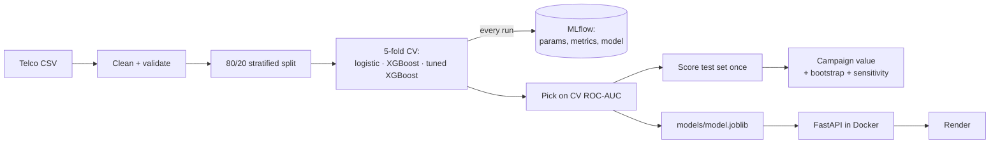
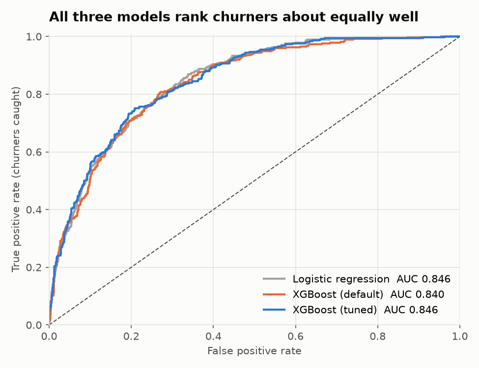
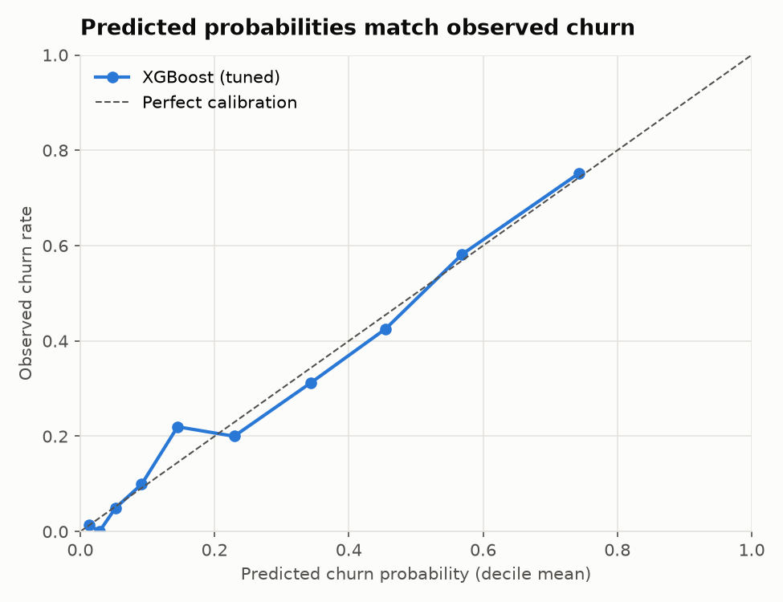
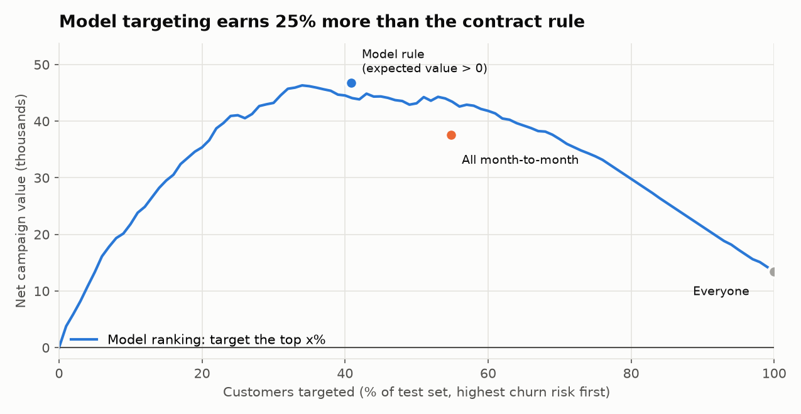
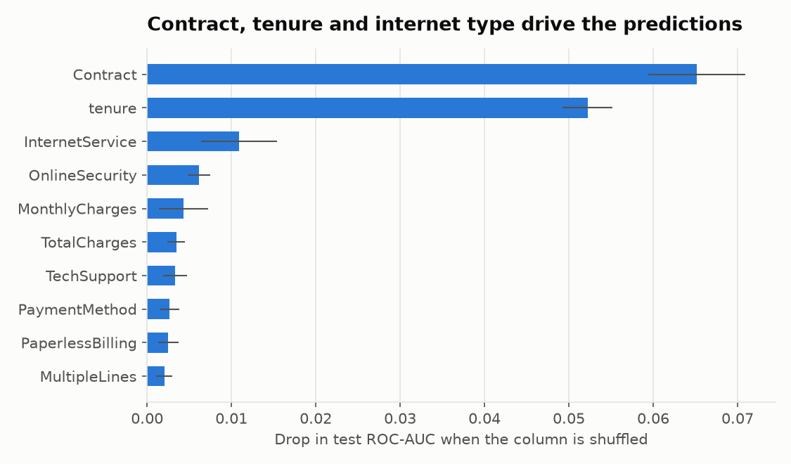

# Customer Churn: From Model to Deployed API

**A retention campaign targeted by this model earns 25% more than the usual rule of "call every
month-to-month customer" ($46.8k vs. $37.6k on 1,409 held-out customers, bootstrap 95% CI for the
gain +$6.1k to +$12.9k). It contacts 197 fewer people and still reaches 75% of the customers who
leave. The model is tracked in MLflow, served by a FastAPI app in Docker, and retrained, tested
and smoke-tested by GitHub Actions on every push.**

| | |
|---|---|
| Model | XGBoost, tuned with 5-fold CV: ROC-AUC 0.846 and PR-AUC 0.665 on the untouched test set |
| Decision rule | Send the offer when *P(churn) × 30% saved × 12 months' bill > $60 offer cost* |
| Serving | `POST /predict` returns churn probability, risk band, expected value and a send/don't-send decision |
| MLOps | MLflow experiment tracking, data validation, a test-set quality gate in CI, Docker image, Render blueprint |

---

## Problem

A telecom loses 26.5% of its customers. The retention team can send an offer (a discount plus a
call) to keep people, but each offer costs money, and most customers were never going to leave.
The question isn't "who will churn?" but **"whom is it worth calling?"** That depends on the
churn risk *and* on how much the customer pays, so the model has to produce good probabilities,
not just a ranking.

## Data

| Dataset | Rows | Source |
|---|---:|---|
| IBM Telco Customer Churn | 7,043 customers, 21 columns | [Kaggle](https://www.kaggle.com/datasets/blastchar/telco-customer-churn), via [IBM's copy](https://github.com/IBM/telco-customer-churn-on-icp4d) |

The columns cover demographics, the services each customer has, contract type, billing and
charges, and whether they left in the last month. `churn/data.py` downloads the file on the first
run. It fixes the one known defect (`TotalCharges` is text and blank for the 11 customers with
zero tenure) and checks every batch before training:

- required columns are present;
- no nulls;
- every category is from the known list;
- no negative charges;
- no duplicate customer IDs.

The API enforces the same lists, so bad input gets a 422 instead of a silent wrong answer.

## Approach



1. **Features.**
   - The 19 raw columns are one-hot encoded.
   - Three engineered features are added: number of services, current bill vs. average bill to
     date (a price-rise signal), and a new-customer flag (≤ 6 months).
   - Everything sits in one scikit-learn `Pipeline`, so the API applies exactly the training
     transformations.
2. **Models.**
   - A logistic-regression baseline, XGBoost with defaults, and XGBoost tuned by a 30-candidate
     random search.
   - Every run is logged to MLflow with its parameters, CV and test metrics, and the model
     itself.
   - The winner is chosen on cross-validation only. The test set is scored once, at the end.
3. **Decision rule.**
   - The expected value of an offer is *P(churn) × save rate × 12 × monthly bill − offer cost*.
   - Send the offer when that is positive.
   - The rule uses each customer's own bill, so a $100/month customer gets an offer at a lower
     risk than a $20/month one.
4. **Evaluation.**
   - Campaign value is measured on the test set against simple rules.
   - A bootstrap gives the uncertainty.
   - A 3×3 grid of other save rates and offer costs checks that the conclusion doesn't depend on
     the assumptions.

## Results

### 1. Tuned XGBoost wins, narrowly



| Model | CV ROC-AUC | Test ROC-AUC | Test PR-AUC | Test Brier |
|---|---:|---:|---:|---:|
| Logistic regression | 0.847 | 0.846 | 0.652 | 0.136 |
| XGBoost (default) | 0.843 | 0.840 | 0.646 | 0.138 |
| **XGBoost (tuned)** | **0.849** | **0.846** | **0.665** | **0.135** |

The honest reading: on this dataset a well-built logistic regression is almost as good. Tuning
mattered more than the algorithm, since default XGBoost was the worst of the three. The tuned
model ended up shallow (depth 2, 366 trees, learning rate 0.02), which suggests the signal is
mostly additive.

### 2. The probabilities can be trusted



Predicted and observed churn rates line up across deciles, so the probabilities can go straight
into the expected-value rule without recalibration.

### 3. The decision rule is where the money is



| Policy (test set, 1,409 customers) | Contacted | Churners reached | Hit rate | Net value |
|---|---:|---:|---:|---:|
| Do nothing | 0 | 0% | – | $0 |
| Everyone | 1,409 | 100% | 26.5% | $13,434 |
| All month-to-month contracts | 773 | 88.0% | 42.6% | $37,566 |
| Model: top 20% by risk | 282 | 50.3% | 66.7% | $35,380 |
| **Model: expected value > 0** | **576** | **75.1%** | **48.8%** | **$46,799** |

- The gain over the month-to-month rule is **+$9,233 (+25%)**, with a bootstrap 95% CI of
  **+$6,054 to +$12,857**. It was positive in all 2,000 resamples.
- **Robustness:** across save rates of 15/30/45% and offer costs of $30/$60/$120, the model rule
  beats the month-to-month rule in all 9 scenarios. The gain ranges from +$4.6k to +$51k; see
  [`results.md`](reports/results.md). The rule adapts to expensive offers by contacting fewer
  people, while the contract rule turns loss-making.

### 4. What drives churn



Contract type and tenure dominate. Next come fibre-optic internet and the lack of online
security or tech support. Month-to-month customers in their first months, on fibre, paying by
electronic check, are the highest-risk group.

## Recommendations

| # | Recommendation | Why |
|---|---|---|
| 1 | Replace the "all month-to-month" call list with the model's send/don't-send flag | +25% campaign value and 197 fewer calls per 1,409 customers |
| 2 | Run it as a randomised test before rolling out: hold out 20% of flagged customers | The 30% save rate is an assumption; a holdout measures the real one, which then goes back into `model.py` |
| 3 | Offer 1- and 2-year contracts at onboarding, and bundle security and tech support with fibre | These are the strongest churn drivers that the business controls |
| 4 | Retrain monthly in CI and promote only if the quality gate passes | The pipeline already retrains, tests and rebuilds the image on every push |

## API

```bash
curl -X POST http://localhost:8000/predict -H "Content-Type: application/json" \
     -d @tests/example_customer.json
```

```json
{"churn_probability": 0.7877, "risk_band": "high", "expected_value_of_offer": 210.8, "send_offer": true}
```

| Endpoint | What it does |
|---|---|
| `GET /health` | Model name, training time and test AUC |
| `POST /predict` | Scores one customer |
| `POST /predict/batch` | Scores up to 1,000 customers |
| `GET /docs` | Interactive Swagger UI with a worked example |

## How to run

```bash
python -m venv .venv
.venv/Scripts/activate            # Windows; on macOS/Linux: source .venv/bin/activate
pip install -r requirements.txt
python -m churn.train             # downloads the data, trains, logs to MLflow, writes reports/ and models/
python -m pytest                  # data checks, quality gate, API tests
uvicorn churn.api:app --reload    # http://localhost:8000/docs
mlflow ui --backend-store-uri sqlite:///mlflow.db   # compare runs at http://localhost:5000
```

**Docker:**

```bash
docker build -t churn-api .
docker run -p 8000:8000 churn-api
```

**Deploy (free):** on [Render](https://render.com), choose *New → Blueprint* and pick this repo.
`render.yaml` builds the Dockerfile and uses `/health` as the health check.

## CI

[`.github/workflows/ci.yml`](.github/workflows/ci.yml) runs on every push:

1. Retrains the model with a quick search.
2. Runs the 15 tests, including a **quality gate**: the saved model must reach test ROC-AUC ≥ 0.82.
3. Builds the Docker image.
4. Starts the container and checks `/health` and `/predict`.

## Structure

```
churn/
  data.py        download, clean, validate, split
  model.py       features, pipelines, campaign-value maths
  train.py       CV, tuning, MLflow tracking, bootstrap, sensitivity, saves the model
  report.py      results.md and charts
  api.py         FastAPI service with typed input validation
models/          model.joblib + metadata.json (served by the API)
tests/           data validation, quality gate, campaign maths, API
reports/         results.md and figures/
Dockerfile, render.yaml, .github/workflows/ci.yml
```

## Caveats

- The campaign economics are assumptions: a $60 offer, 30% of churners saved, and 12 months of
  revenue kept. The sensitivity grid shows the conclusion holds across a wide range, but the
  dollar figures don't.
- The data is a single snapshot with no dates, so the model can't be checked for drift over time.
  In production you'd monitor the score distribution and actual churn each month.
- The model predicts who leaves, not who an offer would *change*. An uplift model, trained on
  data from a randomised campaign, is the next step (recommendation 2 generates that data).
